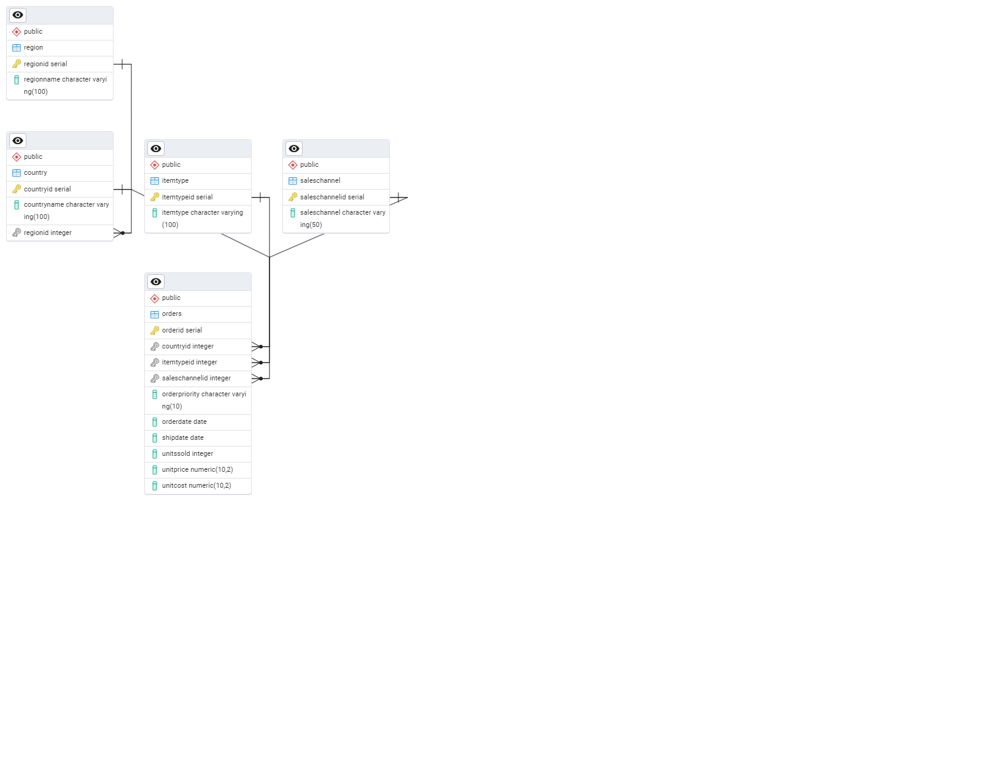

# EcoMart retail reporting with PostgreSQL and MongoDB

I designed a PostgreSQL database so EcoMart managers could compare quarterly revenue, regional profit and product performance across **100,000 sales records**. I used MongoDB for a different set of questions about member purchases and product attributes. In the coursework timing comparison, the regional profit query returned the same seven rows in **71 ms after indexing**, compared with 89 ms before.

[Review the PostgreSQL reporting queries](sql/04_queries.sql) · [See the timing comparison](#query-optimization) · [Explore the MongoDB queries](mongo/03_queries.js)

## Relational design

A staging table accepts the sales CSV. SQL then loads five normalized tables. Each order references a country, item type and sales channel, and each country belongs to a region. Storing those relationships once gives the three management reports a consistent definition of region and product. Reusable views expose the aggregations to reporting tools. [Schema](sql/02_schema.sql) · [Staging and load](sql/03_load_from_staging.sql) · [Reporting views](sql/07_views.sql)

## Query optimization

The original D597 Task 1 report records how long pgAdmin took to complete three management reports before and after the indexing step. Both runs used the 100,000-order dataset. Each query returned the same number of rows in both runs.

| PostgreSQL report | Rows returned | Before indexing | After indexing |
|---|---:|---:|---:|
| Quarterly revenue and profit | 31 | 80 ms | 73 ms |
| Revenue and profit by region | 7 | 89 ms | 71 ms |
| Product performance by item type | 12 | 89 ms | 76 ms |

The regional report had the largest observed difference at 18 ms. Section F4 records one timing per query in each condition. Establishing a repeatable speedup would require multiple runs under comparable conditions. [Reporting queries](sql/04_queries.sql) · [Index definitions](sql/05_indexes.sql)

For the product report, the coursework also explores aggregating orders by item type before joining the product names. The repository includes both a subquery and a common table expression for that approach. The MongoDB project separately covers indexes for member purchases and cosmetic product searches. [SQL aggregation examples](sql/06_optimization_examples.sql) · [MongoDB optimization examples](mongo/04_indexes_and_optimization.js)

## NoSQL project

The grocery query ranks members by purchase count. The cosmetics queries find highly rated products for combination skin and search ingredients for a marketing brief. The cosmetics index includes skin type and rank. The product query also sorts ties by name. For the ingredient search, the rank filter narrows the products to check for a substring. [Collection definitions](mongo/01_create_collections.js) · [Aggregation and search queries](mongo/03_queries.js)

## Load the data

From the repository root, run these commands against an empty PostgreSQL database named `ecomart`. The second command wraps the sales import in a single transaction. The final count should be 100,000.

~~~sh
psql -v ON_ERROR_STOP=1 -d ecomart -f sql/02_schema.sql
psql -v ON_ERROR_STOP=1 --single-transaction -d ecomart -f sql/03_load_from_staging.sql
psql -d ecomart -c "SELECT count(*) FROM orders"
~~~

To compare timings yourself, run the three reporting queries before and after applying the index definitions. For MongoDB, the import script provides the `mongoimport` commands for both included JSON arrays. [Index definitions](sql/05_indexes.sql) · [MongoDB import commands](mongo/02_import_commands.sh) · [Dataset notes](data/README.md)

*WGU M.S. in Data Analytics coursework, D597 Data Management.*
